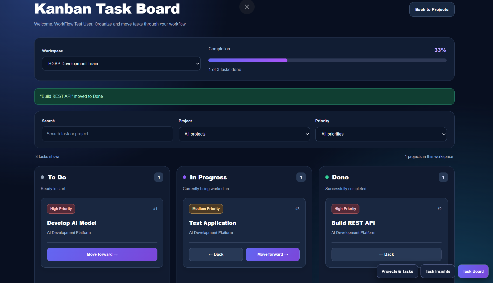
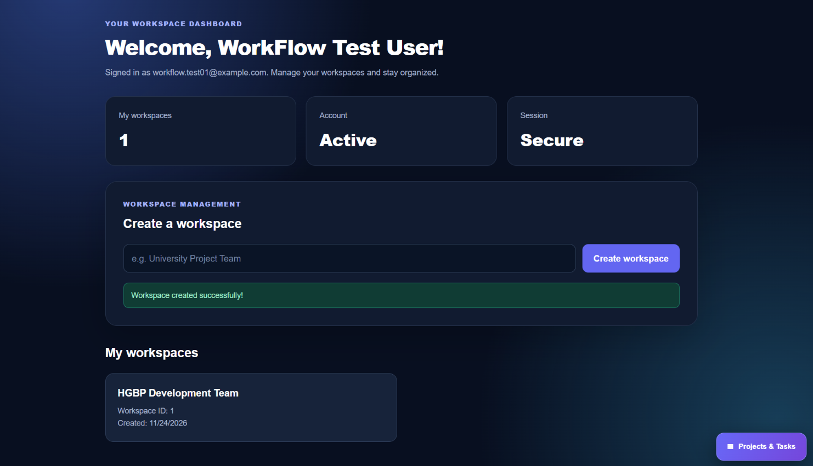
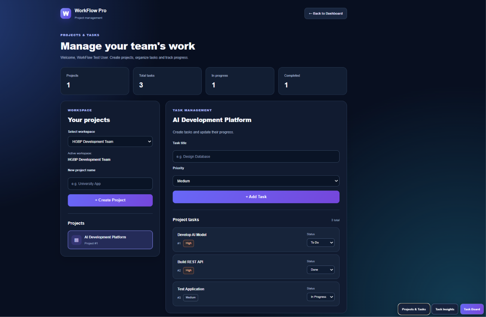
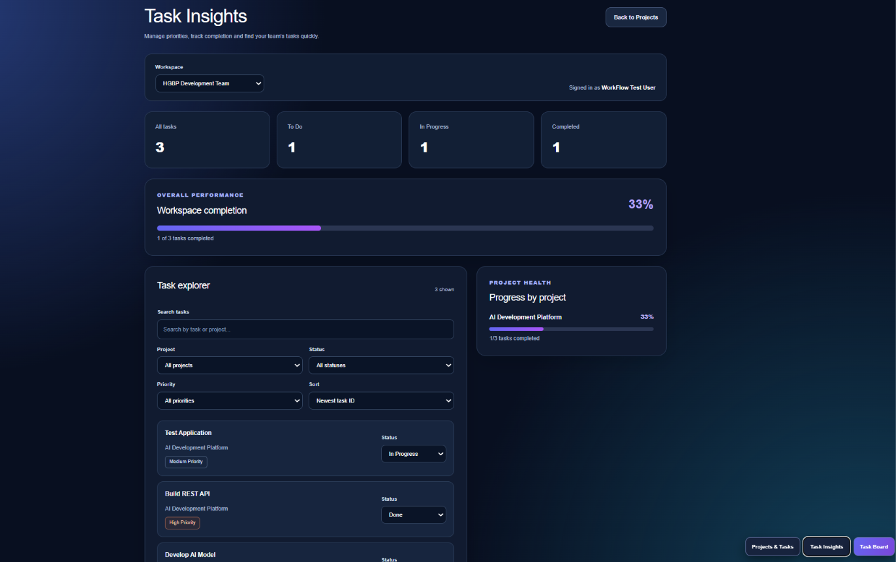
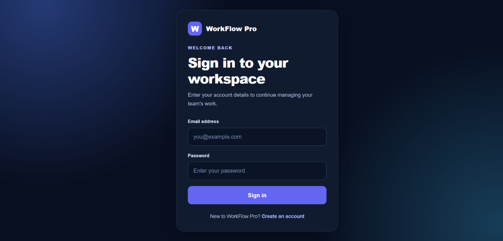
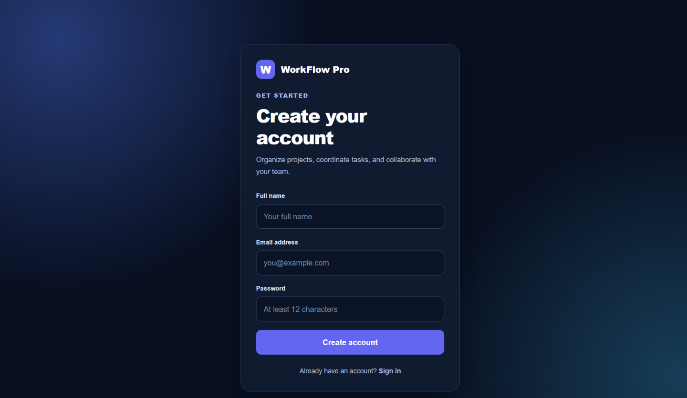
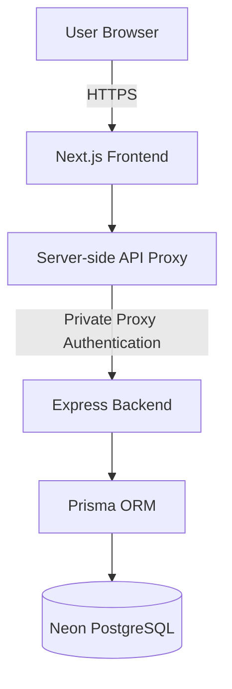

# WorkFlow Pro

A full-stack project and task management platform for organizing workspaces, managing priorities and tracking project progress.

## Live Application

**[Launch WorkFlow Pro](https://workflow-pro-weld.vercel.app)**

Create an account, organize projects, manage tasks and explore the Kanban board using sample data.

## Application Preview

## Key Features

- Account registration and authentication
- Personalized workspace dashboard
- Workspace and project management
- Task creation and priority management
- To Do, In Progress and Done workflows
- Kanban task board
- Task search and filtering
- Project completion insights
- Persistent PostgreSQL storage
- Responsive user interface

## Screenshots

### Workspace Dashboard

### Projects and Tasks

### Task Insights

### Authentication

| Sign In | Create Account |
| --- | --- |
|  |  |

### Additional Views

- [Project creation](docs/screenshots/04-projects.png)
- [Mobile dashboard](docs/screenshots/07-mobile-view.png)

## Technology Stack

| Layer | Technology |
| --- | --- |
| Frontend | Next.js, React, TypeScript |
| Backend | Node.js, Express, TypeScript |
| Database | PostgreSQL, Neon |
| ORM | Prisma |
| Authentication | Argon2id and session-based authentication |
| Validation | Zod |
| Security | Helmet, CSRF protection, proxy authentication, rate limiting |
| Deployment | Vercel |
| Version Control | Git and GitHub |

## System Architecture

The frontend and backend are deployed independently. The server-side proxy connects the frontend to the Express API without exposing the shared authentication secret to the browser.

## Security Design

- Argon2id password hashing and session-based authentication
- Secure HTTP-only session cookies and CSRF protection
- Workspace membership and role-based access controls
- Server-side input validation
- Database-backed authentication rate limiting
- Protected backend API access and server-side environment variables

## Deployment Verification

- Production frontend and backend deployments completed.
- PostgreSQL migrations successfully applied.
- Production API health check returned HTTP 200.
- Unauthorized direct backend requests returned HTTP 403.
- Browser testing demonstrated registration, login, workspace creation, project creation, task creation and status updates.
- A second test account displayed a separate empty workspace dashboard.

Authenticated cross-account API authorization and additional security verification remain pending.

## Project Documentation

[Cloud Deployment and Verification](docs/cloud-deployment.md)

## Project Status

WorkFlow Pro is a publicly accessible portfolio demonstration with a functioning cloud backend and persistent database. It is not a security-audited enterprise service. Use sample data rather than confidential information.

## Developer

**Hasitha Gayan** — AI and Full-Stack Development

- [GitHub](https://github.com/HasithaGayan)
- [Developer Portfolio](https://hasithagayan.github.io/ai-fullstack-87/)

---

Built as part of an AI and Full-Stack engineering development journey.
