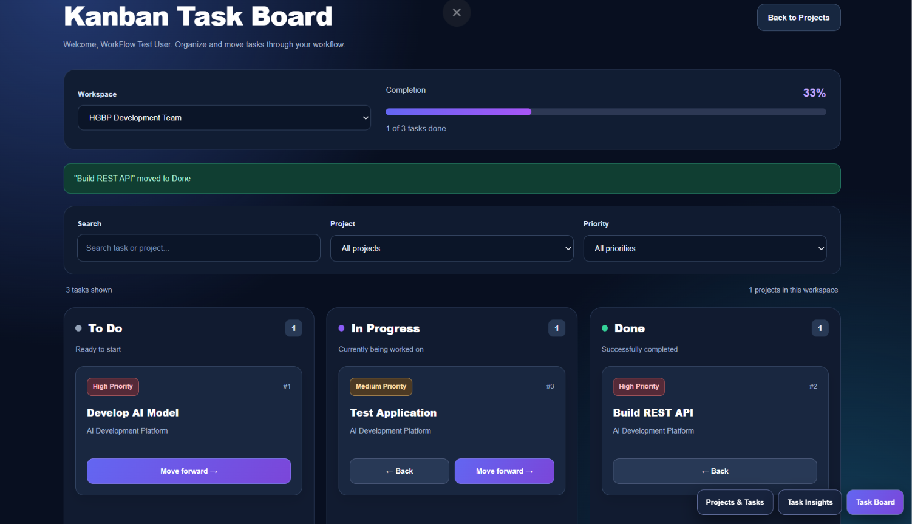
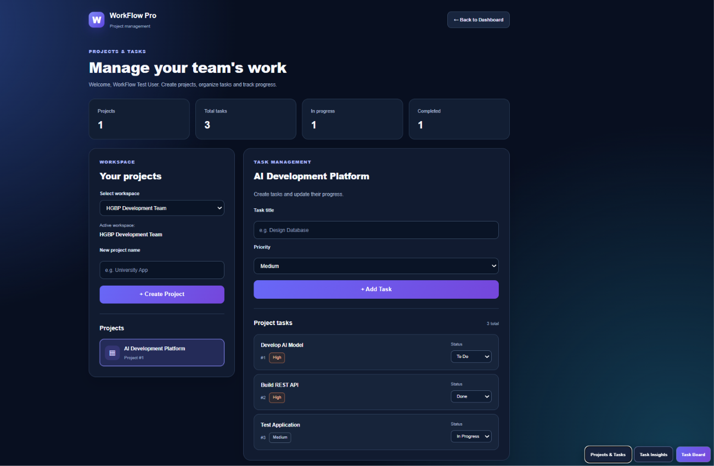
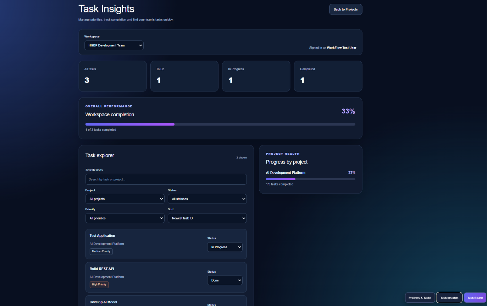
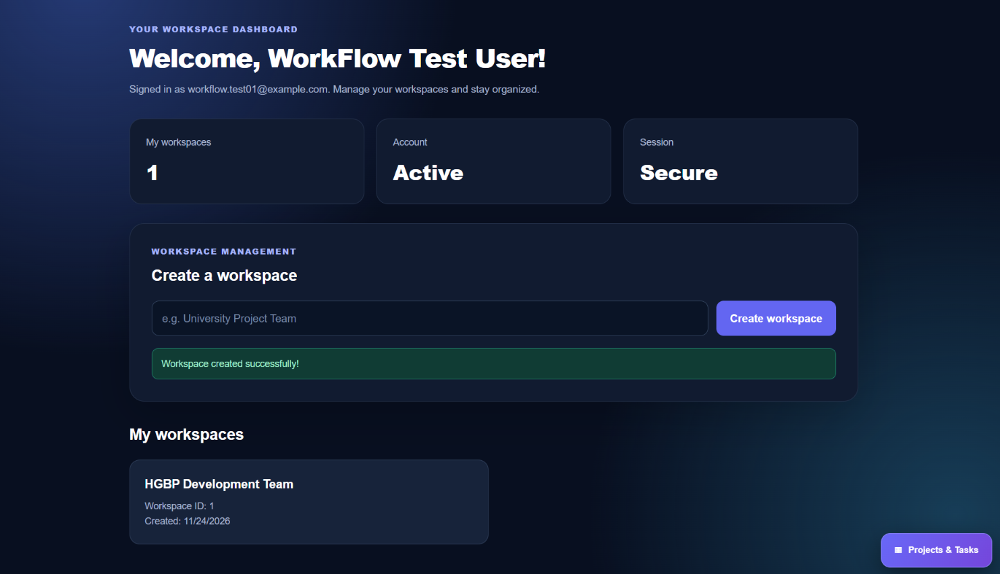

# WorkFlow Pro — Cloud Deployment

WorkFlow Pro is a full-stack project and task management application with account-based workspaces, project organization, task priorities, status tracking, a Kanban board and task insights.

**Live application:** [Open WorkFlow Pro](https://workflow-pro-weld.vercel.app)

## Architecture

```text
Browser → Next.js frontend → server-side API proxy → Express API → Neon PostgreSQL
```

The frontend and API are deployed separately on Vercel. Prisma manages the PostgreSQL schema and migrations. The server-side proxy uses a private authentication key; direct requests to protected backend routes without that key were rejected during deployment testing.

## Screenshots

The images below are genuine captures from the deployed application using sample test data.

### Kanban task board



### Project and task management



### Task insights



### Workspace dashboard



Additional views: [Sign in](screenshots/01-login.png) · [Registration](screenshots/02-register.png) · [Project creation](screenshots/04-projects.png) · [Mobile dashboard](screenshots/07-mobile-view.png).

## Deployment verification

- Both production deployments completed successfully.
- Three database migrations applied; Prisma reported an up-to-date schema.
- API health endpoint returned HTTP 200; direct unauthenticated backend requests were rejected with HTTP 403.
- Browser testing demonstrated registration, login, workspace and project creation, task creation and task status changes.
- A second test account showed an empty workspace dashboard. Authenticated cross-account API authorization and additional security checks require separate verification.

This application is a portfolio demonstration, not a security-audited service. Use sample data rather than confidential or sensitive information.
