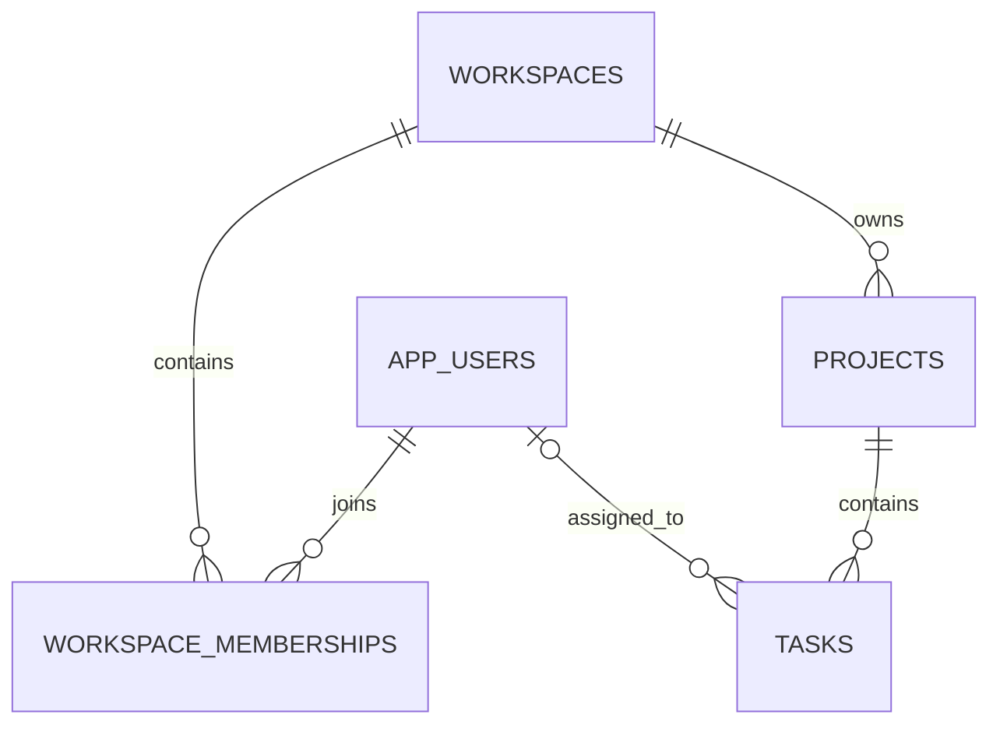

# WorkFlow Pro — Database Design

## Overview

PostgreSQL 18 relational database for a team and project
management SaaS application.

Database: workflow_pro_dev
Development database account: workflow_app

## Entity Relationship Diagram



## Tables

1. app_users — User profile information.
2. workspaces — Team workspaces.
3. workspace_memberships — Users, workspaces and roles.
4. projects — Projects belonging to workspaces.
5. tasks — Project tasks, assignments and deadlines.

## Database Integrity

- Primary keys identify records uniquely.
- Foreign keys enforce relationships.
- UNIQUE constraints prevent specified duplicates.
- CHECK constraints restrict roles, statuses and priorities.
- Transactions group changes using COMMIT and ROLLBACK.

## SQL Scripts

- schema.sql — Exported database structure without records.
- day42-practice.sql — Fictional demonstration records and
  INSERT, SELECT, UPDATE, DELETE and JOIN practice.

## Current Limitations

- The Express backend is not yet connected to PostgreSQL.
- No real user registration or authentication exists.
- Task assignment does not yet enforce workspace membership.
- Database migrations and production security controls are pending.
- This database is for local development, not public production use.
```
